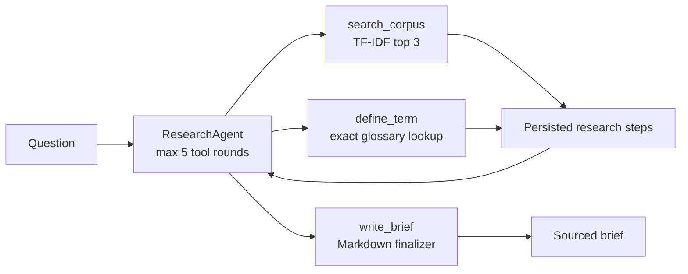

# Agent Research Desk

Agent Research Desk is a small, recruiter-ready research product for Harbor Desk, a fictional operations team. Ask a question, inspect each persisted tool call, and read a concise brief grounded in the local reference corpus. The first version has no live web search, real customer data, or external client dependencies.

## How the agent works



The agent asks an `App\Services\Llm\LlmClient` for one action at a time. The only tools available are `search_corpus`, `define_term`, and `write_brief`; every tool input and output is stored as a `ResearchStep`. Corpus search ranks the eight seeded playbooks locally with TF-IDF and returns at most three hits. A missing glossary entry is represented as a normal tool result, so the agent can explain the miss instead of failing the request.

With `GEMINI_API_KEY` configured, the app uses Gemini Flash to choose actions and compose the final brief. Requests have a 12-second timeout. If Gemini is missing or unavailable, the interface uses a deterministic `FakeLlmClient` fallback; the app continues to run without credentials and an SLA question searches the corpus before writing a brief. Tool rounds are capped at five and agent errors are recorded as failed jobs rather than bubbling into an unhandled error page.

## Run locally without an API key

Requirements: PHP 8.3+, Composer, Node.js, and npm.

```bash
composer install
cp .env.example .env
php artisan key:generate
```

The default `.env.example` uses SQLite. Create the SQLite file if it does not exist, then migrate, seed, and build the Vue app:

```bash
touch database/database.sqlite
php artisan migrate --seed
npm install
npm run build
php artisan serve
```

On Windows PowerShell, replace `cp` with `Copy-Item .env.example .env` and `touch` with `New-Item -ItemType File database/database.sqlite` (only if the file is missing). No Gemini key is needed. Open `http://127.0.0.1:8000` and try **“What is our SLA for P1?”** or **“Define dwell time”**.

To use Gemini optionally, set `GEMINI_API_KEY` in `.env` and restart the app. The model can be changed with `GEMINI_MODEL` (defaults to `gemini-2.5-flash`).

## Demo data

`php artisan migrate --seed` installs eight English Harbor Desk playbooks and six glossary entries. Data is synthetic and includes incident response, service levels, shift handover, escalation, dispatch, customer updates, operations reporting, and dwell-time measurement. No login or demo credentials are needed.

## Tests

Run `php artisan test`. Pest feature tests verify that:

- the no-key service binding resolves to `FakeLlmClient`;
- the P1 SLA question persists a `search_corpus` step, cites the matching playbook, and finishes with a non-empty brief;
- an unknown glossary term is saved as a tool miss and responds without a 500;
- a simulated Gemini timeout falls back to local research;
- the home page exposes the expected seeded corpus and glossary counts.

The tests use SQLite in memory and never make a network request.

## Stack

- Laravel 13 / PHP 8.3+
- Vue 3, Inertia, and Tailwind CSS
- SQLite by default; no Redis required
- Optional Gemini through the `LlmClient` interface
